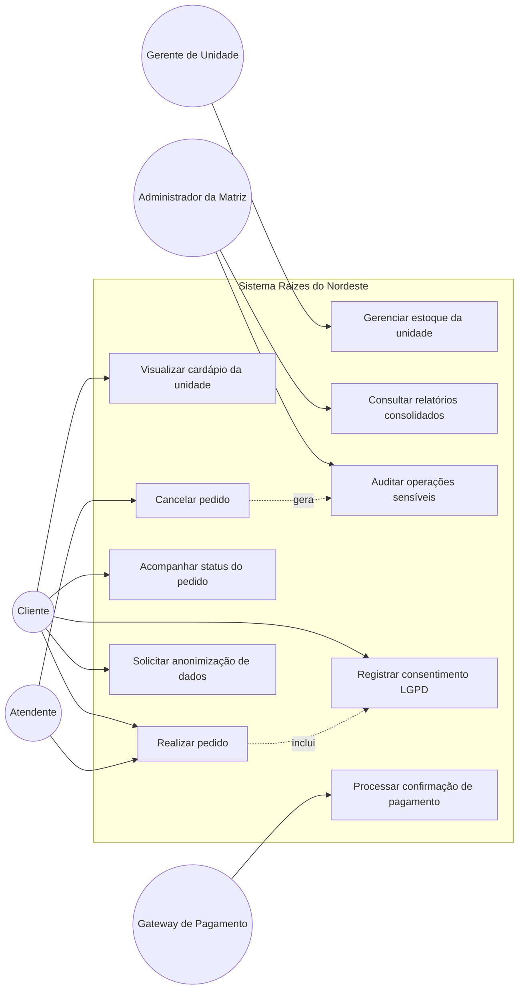

# Diagrama de Casos de Uso

Atores:
- **Cliente** — consome o serviço pelos canais app, totem, balcão (via atendente) ou pickup.
- **Atendente** — opera o totem/balcão, registra pedidos manualmente quando necessário.
- **Gerente de Unidade** — acompanha estoque e indicadores da própria unidade.
- **Administrador (Matriz)** — consulta relatórios consolidados e auditoria.
- **Gateway de Pagamento** (ator externo/sistema) — confirma ou nega pagamentos.

**Observação:** `Realizar pedido` inclui a verificação de disponibilidade no cardápio da unidade e a checagem de estoque antes de confirmar. `Cancelar pedido` sempre gera um registro de auditoria.
