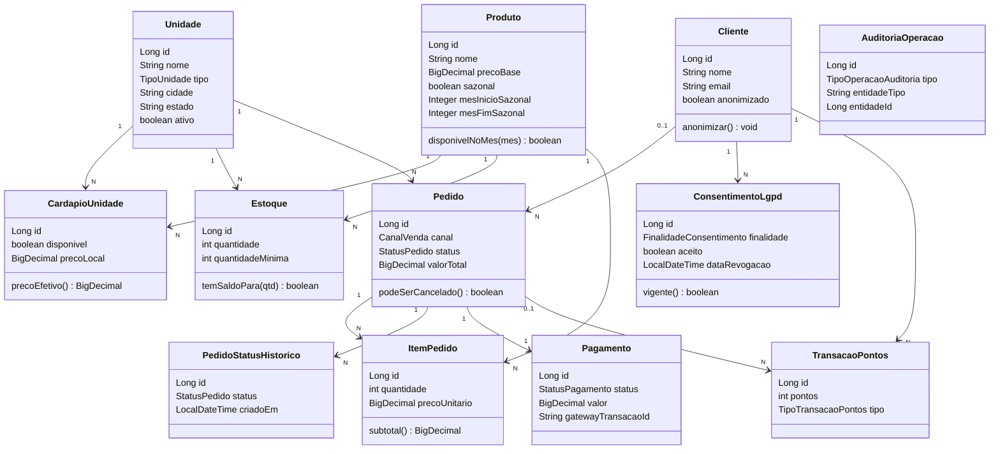

# Diagrama de Classes (visão simplificada do domínio)

**Decisão de modelagem:** `PedidoStatusHistorico` existe como tabela própria (não apenas um campo `status` em `Pedido`) para permitir reconstruir a linha do tempo do pedido e sustentar auditoria/relatórios de tempo de preparo.
