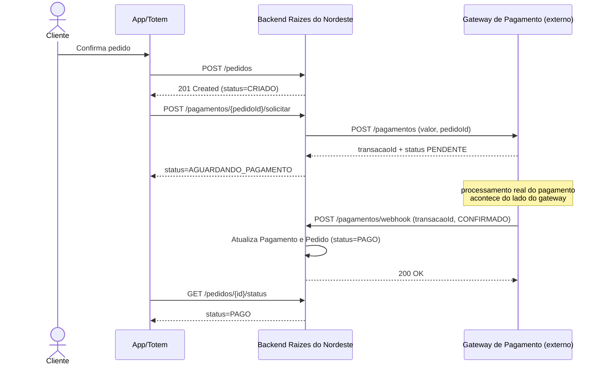

# Diagrama de Sequência — Pagamento Desacoplado

Mostra como o sistema principal nunca processa o pagamento diretamente: ele solicita, e a confirmação chega depois, de forma assíncrona, via webhook.

**Tratamento de falha:** se o webhook nunca chegar, o pedido permanece em `AGUARDANDO_PAGAMENTO`; um job de conciliação (fora do escopo implementado) consultaria o gateway periodicamente para pedidos pendentes há mais de X minutos. O endpoint de webhook é idempotente (reenvios com o mesmo `gatewayTransacaoId` não duplicam o efeito).
